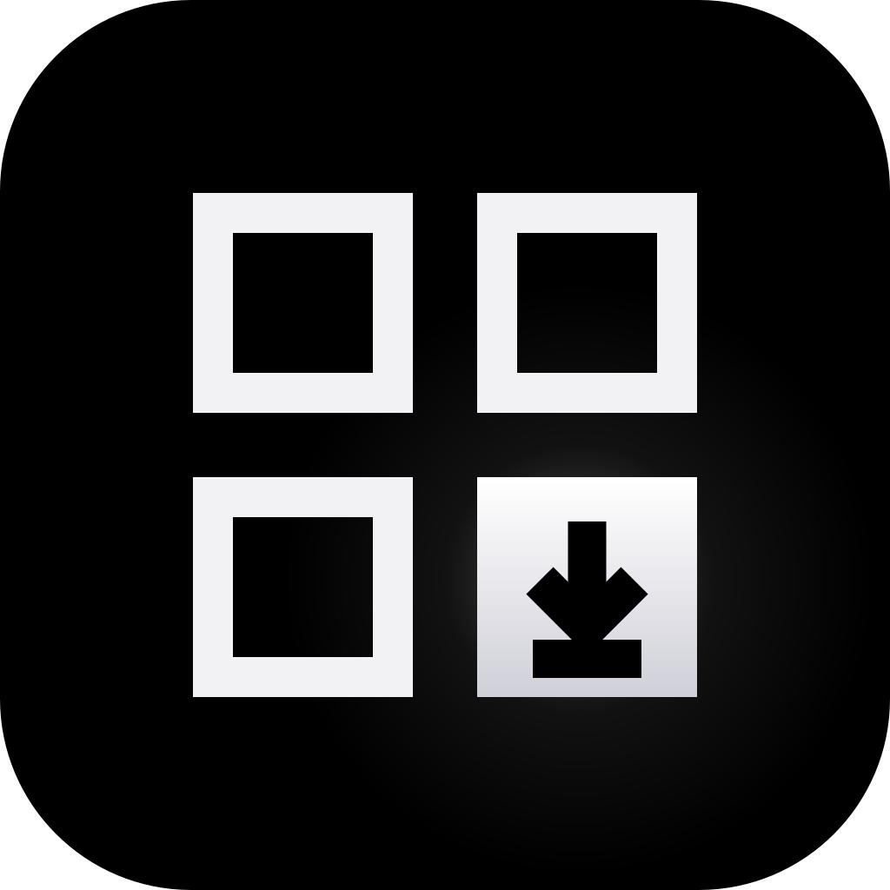
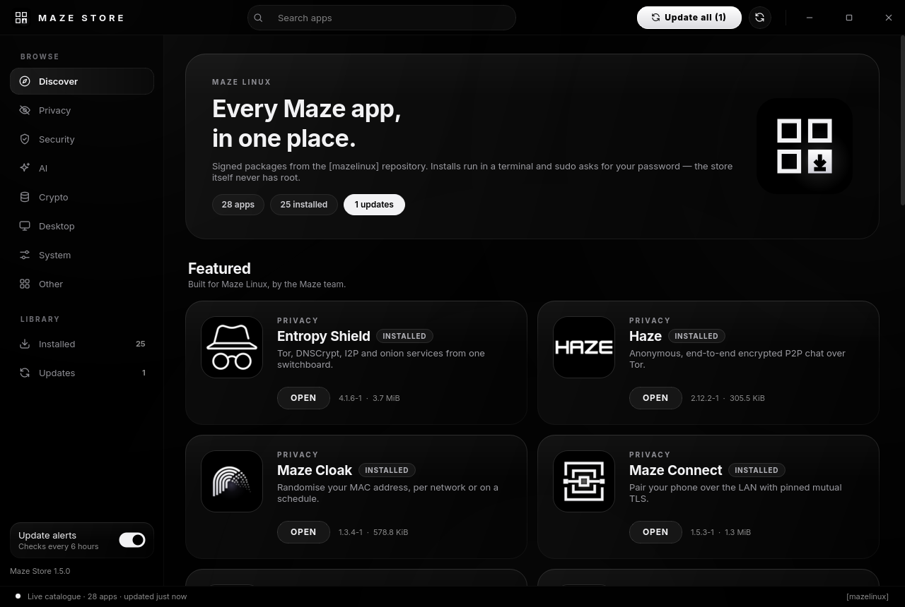
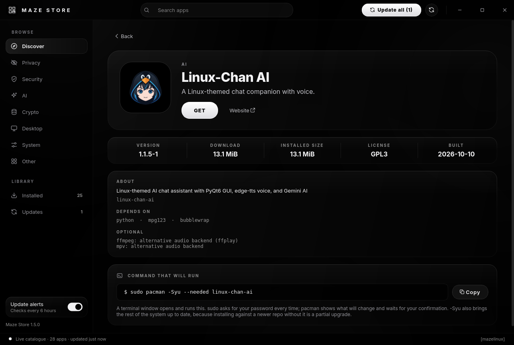
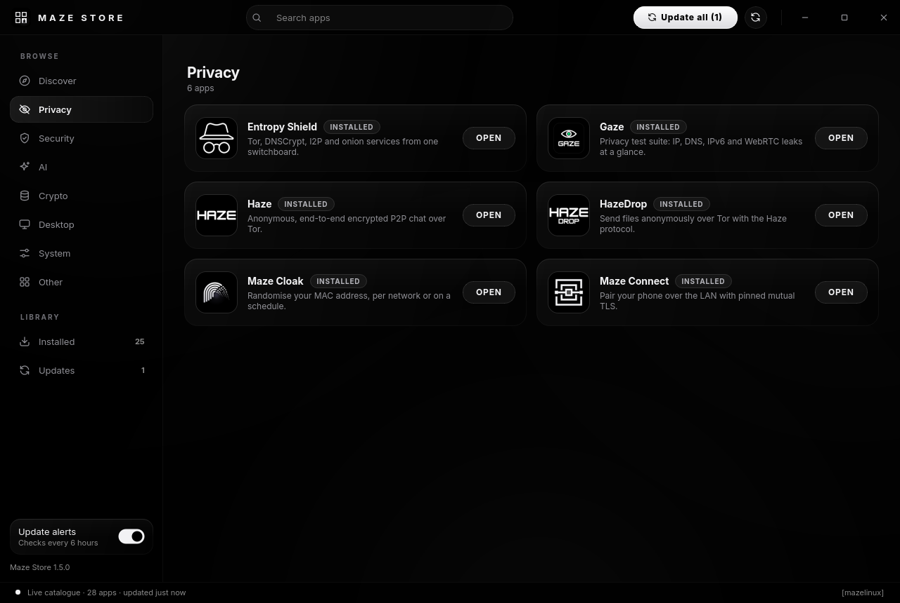

<div align="center">



# MAZE STORE

**The app store for Maze Linux**

*Browse the signed [mazelinux] repository · Install in a terminal you can read · No root, ever*

---

[](https://python.org)
[](https://pypi.org/project/PyQt6/)
[](https://archlinux.org)
[](LICENSE)

</div>

---



## What is Maze Store?

Maze Store is the shop window for every Maze Linux app — Maze Guard, Maze Cloak,
Entropy Shield, Haze, Qlam, Maze AI and the rest. It shows what each app does,
which version is out, what is installed and what has an update, and lets you
install, update, open or remove apps with one click.

What it does **not** do is hold any privilege. There is no polkit rule, no
setuid helper and no root daemon. Every change to the system runs in a terminal
window as a plain pacman command behind `sudo -k`:

```
sudo pacman -Syu --needed <package>   # install / update
sudo pacman -Rns <package>            # remove
sudo pacman -Syu                      # update everything
```

You see the exact command before it runs, pacman shows you the transaction and
waits for your confirmation, and **your password is typed into sudo — never into
the store**. `-k` makes sudo ignore a cached timestamp, so the password is asked
every single time.

---

## Features

### Catalogue
- **Live from the repository** — the store downloads `mazelinux.db` over HTTPS
  itself (no root, no `pacman -Sy`), so it is always current. Offline, it falls
  back to its cache, then to pacman's own sync database
- **New packages appear automatically** — anything published to [mazelinux]
  shows up in the store with no code change
- **Curated cards** — names, categories and short pitches in English and Turkish
- **Categories** — Privacy, Security, AI, Crypto, Desktop, System, Other
- **Library** — *Installed* and *Updates*, with counts in the sidebar
- **Search** across names and descriptions in both languages

### Installing
- **Terminal, not a hidden helper** — Konsole by default; GNOME Terminal,
  kgx, xfce4-terminal, Alacritty, kitty, foot, WezTerm and xterm also work
- **Full-upgrade installs** — `-Syu --needed`, because installing against a
  newer repo without upgrading the rest is the partial upgrade that breaks
  Arch systems
- **Package names are validated twice** — in the app and again in
  `maze-store-run` — and passed as separate arguments, never through a shell
- **Live state** — the window watches pacman's local database and refreshes
  the moment a transaction finishes, from the store or anywhere else
- **System components ask twice** before being removed

### Update alerts
- A systemd **user** timer checks for Maze app updates 10 minutes after login
  and then every 6 hours, as you — not as root
- One notification per new version, with a button that opens the store on its
  Updates page; ignoring it does not mean being nagged every six hours
- Turn it off from the switch at the bottom of the sidebar

### Design
- OLED black and white, glass panels, no colour — the same visual language as
  the rest of the Maze suite
- Frameless window with its own title bar, like Maze Guard and Maze Cloak
- Sharp on HiDPI screens; English and Turkish UI

<div align="center">


</div>

---

## Installation

### From the Maze repository

```bash
sudo pacman -S maze-store
```

### Build the package yourself

```bash
git clone https://github.com/berk-kucuk/maze-store.git
cd maze-store
./build-pkg.sh
sudo pacman -U dist-pkg/maze-store-*.pkg.tar.zst
```

`build-pkg.sh` runs the test suite, then `makepkg`. It never asks for
privileges; installing is a separate step you run yourself.

### Run from source

```bash
/opt/maze/venv/bin/python3 main.py            # or any Python with PyQt6
/opt/maze/venv/bin/python3 main.py --lang=en  # force a language (en / tr)
```

---

## Usage

| Command | What it does |
|---|---|
| `maze-store` | Open the store |
| `maze-store --view=updates` | Open straight on a page (`all`, `installed`, `updates`, a category) |
| `maze-store --check-updates --print` | List pending Maze updates in the terminal |
| `maze-store --check-updates` | Run the background check now (posts a notification if needed) |

| Shortcut | |
|---|---|
| `Ctrl+F` | Search |
| `F5` | Refresh the catalogue |
| `Esc` | Back / clear search |

Stop the update timer entirely:

```bash
systemctl --user mask --now maze-store-updates.timer
```

---

## How it works

| Piece | Role |
|---|---|
| `mazestore/core/repo.py` | Finds the [mazelinux] server through `pacman-conf`, caches the db in `~/.cache/maze-store` |
| `mazestore/core/dbparse.py` | Reads the sync db (gzip / zstd tar) in memory — nothing from it touches the disk |
| `mazestore/core/local.py` | `pacman -Q`, a port of libalpm's `vercmp`, and launching installed apps from their `.desktop` files |
| `mazestore/core/catalog.py` | Display names, categories and taglines; hidden packages (debug symbols, plumbing) |
| `mazestore/core/actions.py` | Builds the pacman command and the terminal that runs it |
| `maze-store-run` | Runs inside the terminal: re-validates, prints the command, runs it under `sudo -k` |
| `mazestore/core/checker.py` | The background update check — no Qt imported, a few MB and a fraction of a second |
| `mazestore/gui/` | The window: glass panels, painted pills and switches, line glyphs, frameless title bar |

### Adding an app to the store

Publish it to [mazelinux] and it appears under *Other* with its `pkgdesc`. For a
proper card, add an `Entry` to `mazestore/core/catalog.py` and a 128×128 PNG
named `<pkgname>.png` to `assets/apps/`.

### Files

| Path | Contents |
|---|---|
| `~/.cache/maze-store/mazelinux.db` | Cached catalogue |
| `~/.config/maze-store/settings.json` | Preferences (update alerts on/off) |
| `~/.local/state/maze-store/notified.json` | Versions already announced |

---

## Testing

```bash
python3 -m unittest discover -s tests -v
```

The suite never runs sudo or pacman. It covers the db parser against garbage
input, `vercmp` against pacman's own binary, hostile package names (`-Rdd`,
`--config=…`, `$(id)`), the runner script rejecting them before sudo, the
update check announcing each version exactly once, and the two i18n tables
staying in step.

---

## License

Copyright © 2026 Berk Küçük

GPL3 — see [LICENSE](LICENSE).

---

<div align="center">
<sub>Part of the Maze suite · Built for Maze Linux · Tested on Arch Linux</sub>
</div>
